# Architektur

## Zweck und Geltungsbereich

Dieses Dokument beschreibt die technische Architektur der ADFC-Nextcloud-CLI.
Es richtet sich an Entwickler und Administratoren, die das Werkzeug warten,
erweitern oder betreiben. Die fachliche Bedienung steht in
[`usage.md`](usage.md), die Einrichtung in [`installation.md`](installation.md)
und die Konfiguration in [`configuration.md`](configuration.md).

Die CLI ist ein read-only Administrationswerkzeug. Sie spricht ausschließlich
über HTTPS mit der OCS-Provisioning-API der Nextcloud-Instanz. Es gibt keinen
direkten Datenbankzugriff, kein `occ` und kein SSH.

## Systemkontext

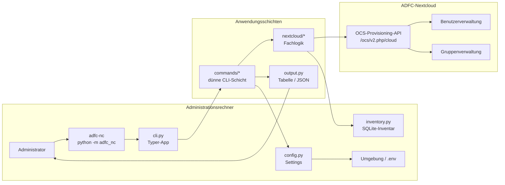

Die CLI liest Benutzer- und Gruppendaten, normalisiert sie lokal und gibt sie
als Rich-Tabelle oder JSON aus. Für Daten, die die OCS-API nicht liefert, führt
sie ein lokales SQLite-Inventar. Schreibende Operationen sind noch nicht
implementiert.

## Schichten und Abhängigkeiten

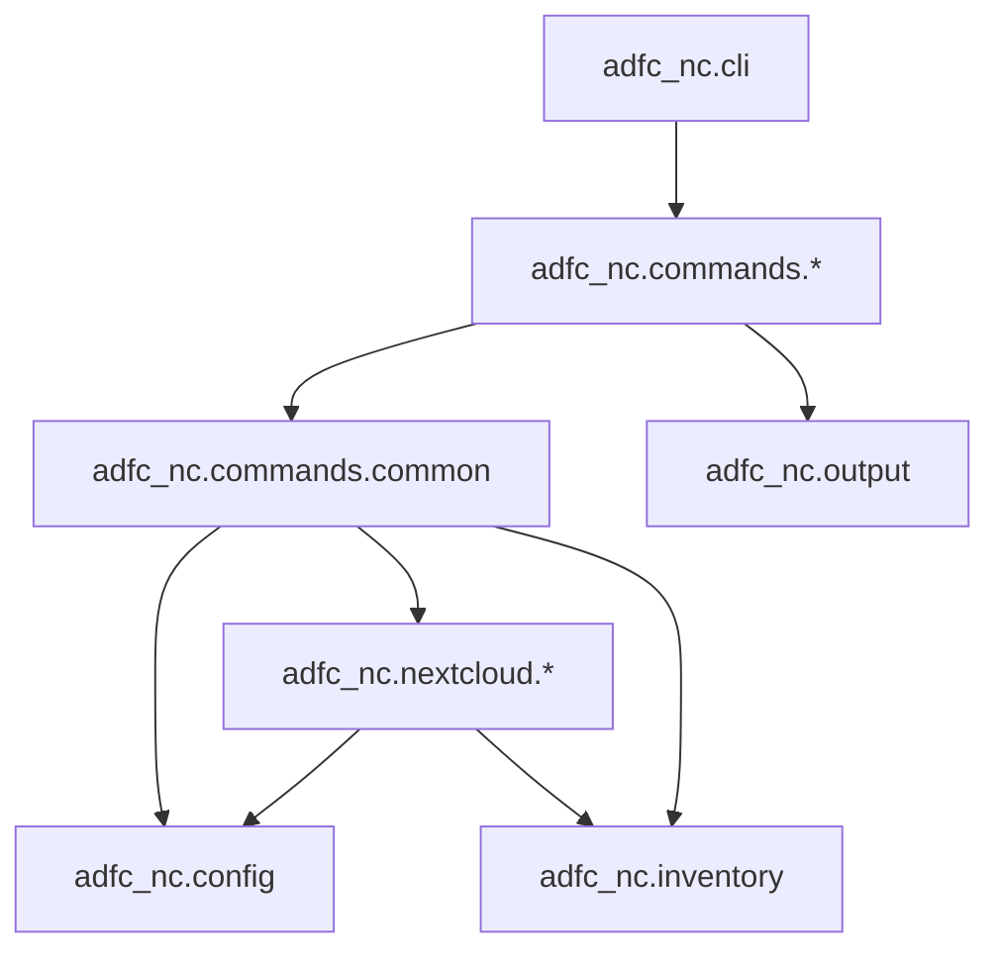

Regeln:

- Die Kommandoebene bleibt dünn: Argumente prüfen, Fachfunktion aufrufen,
  Ergebnis ausgeben.
- HTTP-, Paging-, OCS- und Normalisierungslogik liegen unter
  `src/adfc_nc/nextcloud/`.
- `output.py` kennt nur das `User`-Modell, keine HTTP- oder
  Konfigurationsdetails.
- `nextcloud/client.py` kennt keine Kommandos und keine Ausgabeformate.
- Neue Ressourcen werden als Fachmodul plus dünnes Kommando ergänzt.

## Module

| Modul | Aufgabe |
| --- | --- |
| `adfc_nc.cli` | Typer-App und Registrierung der Befehlsgruppen |
| `adfc_nc.commands.users` | CLI-Optionen, Filter, Sortierung, Hinweise |
| `adfc_nc.commands.inventory` | Synchronisation des lokalen Inventars |
| `adfc_nc.commands.common` | Gemeinsame Fehler- und Exit-Code-Behandlung |
| `adfc_nc.config` | Einstellungen aus Umgebung und `.env` |
| `adfc_nc.inventory` | SQLite-Inventar für `first_seen` und exakte Anlagedaten |
| `adfc_nc.nextcloud.client` | HTTP-Client, Auth, OCS-Prüfung, Paging, Retry |
| `adfc_nc.nextcloud.users` | Benutzer- und Gruppenabfrage, Normalisierung |
| `adfc_nc.nextcloud.errors` | Fehlertaxonomie |
| `adfc_nc.output` | Tabellen- und JSON-Ausgabe |

## Verwendete OCS-Endpunkte

| Endpunkt | Zweck | Status |
| --- | --- | --- |
| `GET /ocs/v2.php/cloud/users/details` | Alle Benutzer mit Details und Gruppen | verwendet |
| `GET /ocs/v2.php/cloud/groups/details` | Gruppenkennung und Anzeigename | verwendet |

Von Nextcloud 34 ergänzend verfügbar, aktuell nicht verwendet:

- `GET /cloud/users/recent` liefert Benutzer sortiert nach letztem Login.
- `GET /cloud/users/disabled` liefert deaktivierte Benutzer.
- `GET /cloud/groups/{groupId}/users/details` liefert Mitglieder einer Gruppe.

## Laufzeit- und Konfigurationsmodell

Die Einstellungen werden über `pydantic-settings` aus Umgebungsvariablen und
optional aus `.env` geladen. Das Präfix ist `ADFC_NC_`.

| Einstellung | Umgebungsvariable | Standard | Verwendung |
| --- | --- | --- | --- |
| `base_url` | `ADFC_NC_BASE_URL` | `https://by.adfc-clouds.de` | Basis-URL des HTTP-Clients |
| `admin_user` | `ADFC_NC_ADMIN_USER` | Pflicht | Basic-Auth für Provisioning |
| `admin_password` | `ADFC_NC_ADMIN_PASSWORD` | Pflicht | Admin-App-Passwort |
| `share_user` | `ADFC_NC_SHARE_USER` | `OCMaster_LV_Nextcloud` | Für spätere Share-Befehle reserviert |
| `share_password` | `ADFC_NC_SHARE_PASSWORD` | leer | Für spätere Share-Befehle reserviert |
| `verify_tls` | `ADFC_NC_VERIFY_TLS` | `true` | TLS-Zertifikatsprüfung |
| `timeout_seconds` | `ADFC_NC_TIMEOUT_SECONDS` | `30` | HTTP-Timeout |
| `cache_ttl_seconds` | `ADFC_NC_CACHE_TTL_SECONDS` | `3600` | Derzeit deklariert, aber ungenutzt |
| `state_dir` | `ADFC_NC_STATE_DIR` | `.adfc-nc` | Verzeichnis des Inventars |
| `resource_user_prefix` | `ADFC_NC_RESOURCE_USER_PREFIX` | `OC` | Präfix für Ressourcenbenutzer |

Die aktuellen Befehle verwenden nur den Admin-Account. Die Share-Zugangsdaten
sind für künftige Files-Sharing-Befehle vorgesehen. `cache_ttl_seconds` ist noch
nicht an einen Cache angebunden.

## Datenfluss: `users list`

`users list` liest ausschließlich live aus der OCS-API und verwendet kein
Inventar.

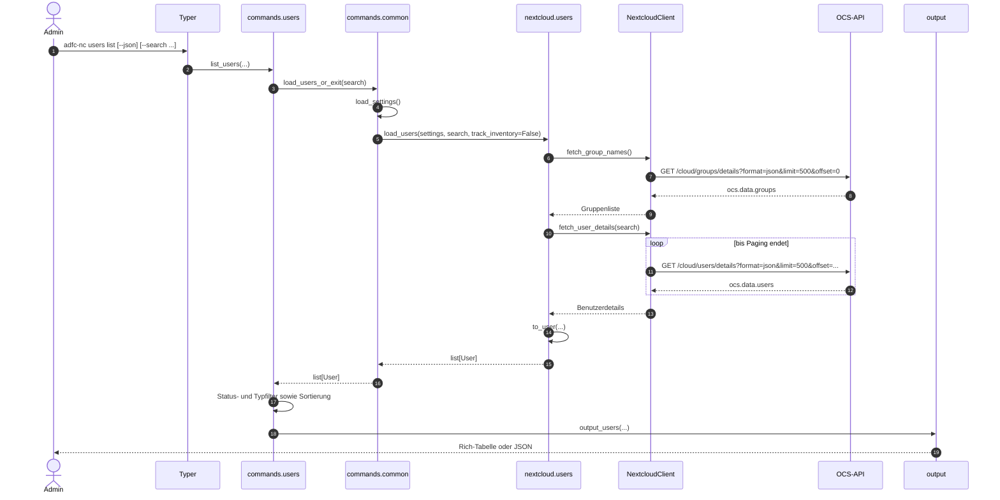

Wichtig: Die Gruppen werden vor den Benutzern geladen, damit die
Gruppenkennungen in `group_names` aufgelöst werden können. `--search` wird bei
`users list` an die OCS-API übergeben; bei `users stale` filtert die CLI lokal.
Fehler beim Laden werden zentral in `commands.common` in Meldungen und
Exit-Codes übersetzt.

## Datenfluss: `users stale` und Inventar

`users stale` benötigt das Inventar, weil die OCS-API kein Anlagedatum liefert.
Der Ablauf kombiniert Live-Benutzerdaten mit gespeicherten Sichtungen und
Login-Zeiten.

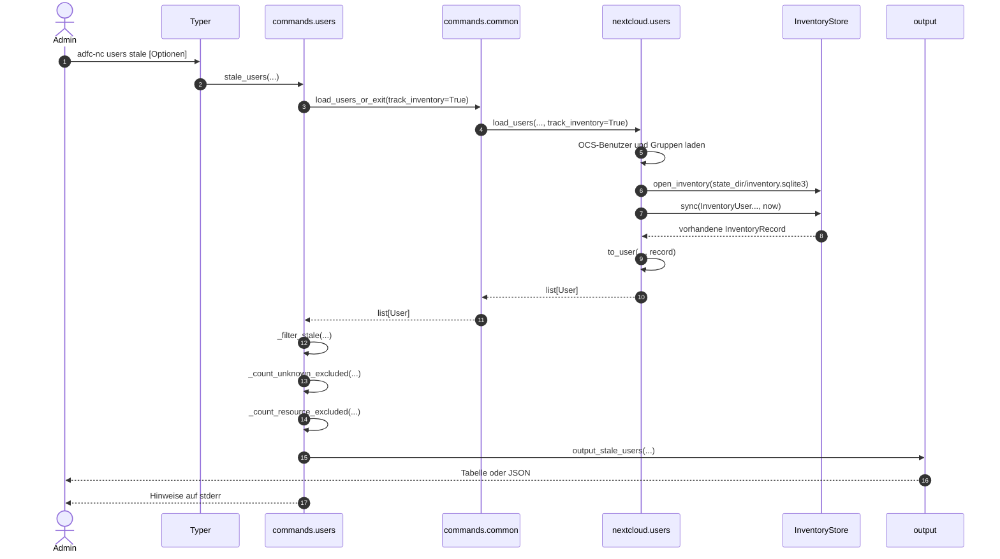

Die Hinweise auf ausgeschlossene Benutzer werden bewusst nach der
Ergebnisausgabe auf `stderr` geschrieben. Dadurch bleibt die JSON-Ausgabe auf
`stdout` maschinenlesbar.

`inventory sync` verwendet denselben Ladepfad mit `track_inventory=True`, führt
aber keine Stale-Filter aus und gibt nur eine Zusammenfassung aus:
`Inventar aktualisiert: <Anzahl> Benutzer.`

## Inventar-Sync und Baseline

Das Inventar liegt standardmäßig unter `.adfc-nc/inventory.sqlite3`. Es wird
beim Öffnen angelegt, falls es fehlt. SQLite läuft im WAL-Modus.

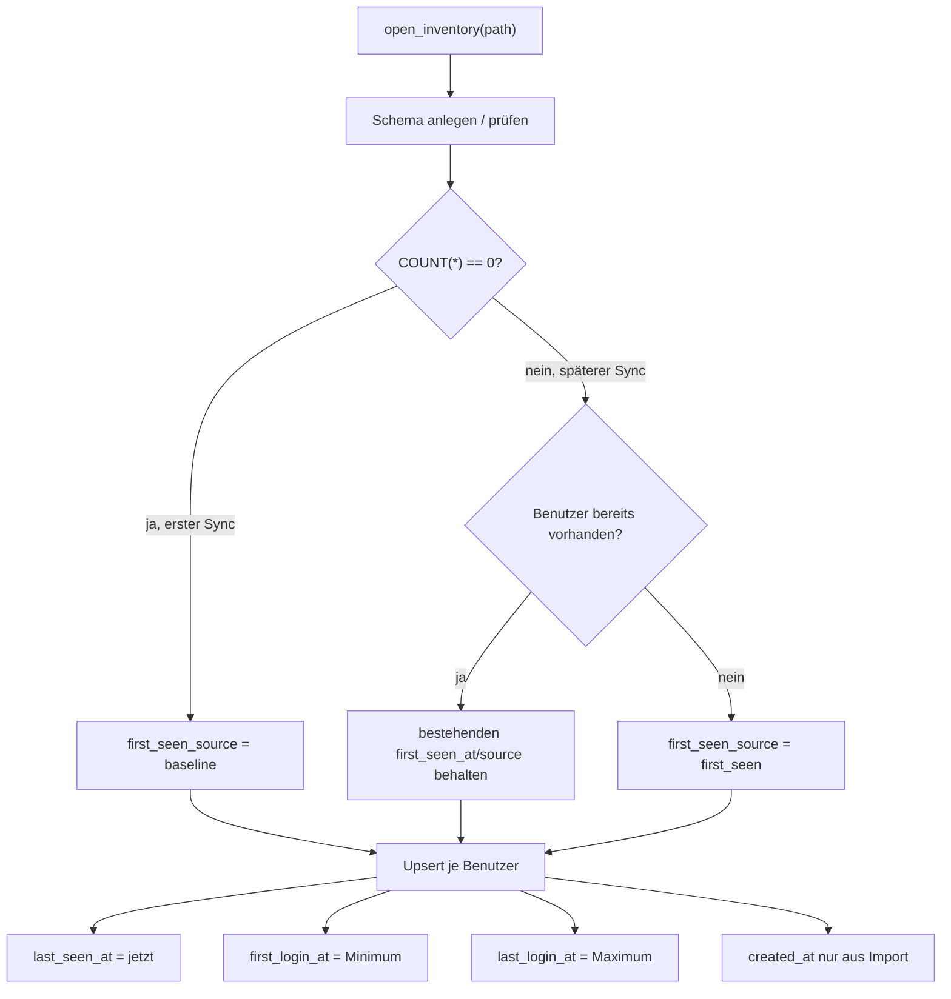

Beim ersten Sync werden alle vorhandenen Benutzer als `baseline` markiert.
Ihre erste Sichtung ist **keine** belastbare Alters-Untergrenze. Erst bei
später neu erscheinenden Benutzern ist `first_seen` eine Untergrenze für das
Alter. Das verhindert, dass bestehende Konten fälschlich als „gerade angelegt“
gelten.

`first_login_at` und `last_login_at` werden monoton geführt: Der früheste
Erstlogin und der späteste Letztlogin bleiben erhalten, auch wenn die API
zwischenzeitlich `0` oder keine Werte liefert. `created_at` und
`created_source` werden nur über einen späteren Import gesetzt und beim Sync
nicht überschrieben.

## Datenmodell

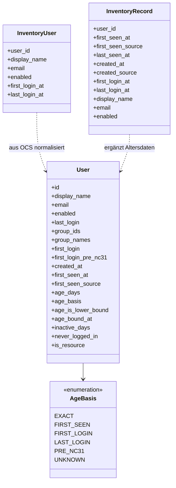

### SQLite-Schema

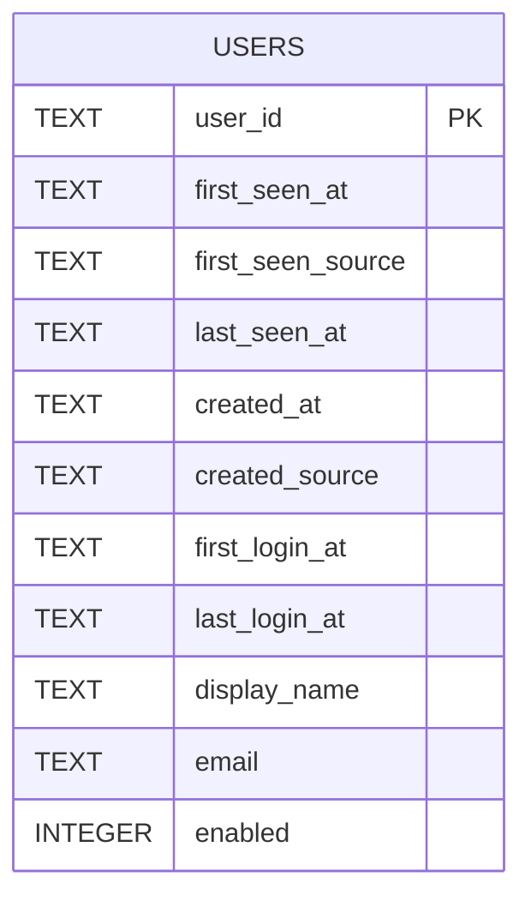

Alle Zeitpunkte werden als ISO-8601-Text gespeichert. `enabled` ist ein
SQLite-Integer (`0`/`1`). Es gibt genau eine Tabelle; Migrationen erfolgen
derzeit minimal über `ALTER TABLE` beim Öffnen.

## Benutzerfelder aus OCS

Aus `users/details` werden verwendet:

| OCS-Feld | Bedeutung |
| --- | --- |
| `id` | Benutzerkennung |
| `displayname` | Anzeigename, Fallback `display-name` |
| `email` | E-Mail-Adresse |
| `enabled` | Aktivierungsstatus |
| `groups` | Liste der Gruppenkennungen |
| `firstLoginTimestamp` | Erstlogin in Sekunden; `-1` = vor Nextcloud 31 |
| `firstLogin` | Fallback für den Erstlogin, falls `firstLoginTimestamp` fehlt |
| `lastLoginTimestamp` | Letzter Login in Sekunden |
| `lastLogin` | Letzter Login in Millisekunden |

## Letzte Anmeldung

Die Normalisierung erfolgt in `parse_last_login`:

1. `lastLoginTimestamp` wird bevorzugt.
2. Fehlt es, wird `lastLogin` verwendet.
3. Werte ab `10^10` gelten als Millisekunden und werden durch 1000 geteilt.
4. `0` und fehlende Werte bedeuten „nie angemeldet“.
5. Die Ausgabe erfolgt in `Europe/Berlin`.

Nextcloud aktualisiert den Login-Zeitstempel bei Passwort- und
Token-/App-Passwort-Logins. Desktop- und Mobile-Clients authentifizieren sich
mit App-Passwörtern, ihre Anmeldungen sind daher enthalten. Die OCS-API liefert
jedoch nur einen kombinierten Wert:

- keine Trennung zwischen Web und Client,
- keine Gerätezuordnung,
- keine verlässliche Aussage über jeden einzelnen Sync.

Für eine Client-only-Auswertung wären zusätzliche Datenquellen nötig:

- `oc_authtoken` mit `name` und `last_activity` (Read-only-Datenbankzugriff),
- Access-Logs des Webservers mit DAV-Pfaden und User-Agents,
- ein serverseitiges `occ`-Kommando oder eine eigene Nextcloud-App.

Diese Wege sind bewusst nicht Teil der aktuellen Implementierung, weil die CLI
ausschließlich über HTTPS mit der OCS-API spricht.

## Erstlogin und Altersberechnung

`parse_first_login` liest `firstLoginTimestamp`, ersatzweise `firstLogin`.
`0` bedeutet „nie angemeldet“, negative Werte markieren `pre_nc31`.

Die Altersberechnung erfolgt in `calculate_age` mit dieser Priorität:

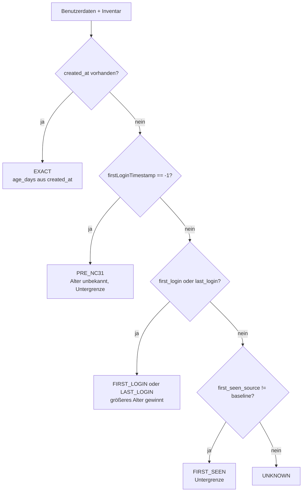

`age_is_lower_bound` ist bei `FIRST_SEEN`, `FIRST_LOGIN`, `LAST_LOGIN` und
`PRE_NC31` gesetzt. Bei `PRE_NC31` gibt es keinen konkreten Zeitpunkt und keinen
Zahlenwert für `age_days`; die Stale-Logik behandelt das Konto dennoch als alt
genug. `EXACT` ist keine Untergrenze.

`users stale` kombiniert das Alter mit `inactive_days` beziehungsweise
`never_logged_in`. Benutzer mit `unknown` werden standardmäßig ausgeschlossen
und separat gezählt.

## Ressourcenbenutzer

Kennungen, die mit `ADFC_NC_RESOURCE_USER_PREFIX` beginnen (Standard `OC`),
werden als Ressourcen- beziehungsweise Dienstbenutzer klassifiziert. Die
Erkennung erfolgt in `to_user` groß-/kleinschreibungssensitiv über
`user_id.startswith(...)`.

Da diese Konten sich häufig nie anmelden, schließt `users stale` sie
standardmäßig aus (`--type user`). Mit `--type all` werden sie einbezogen,
mit `--type resource` ausschließlich geprüft. Die Tabelle zeigt `Benutzer`
beziehungsweise `Ressource`; JSON verwendet die stabilen Werte `user` und
`resource`.

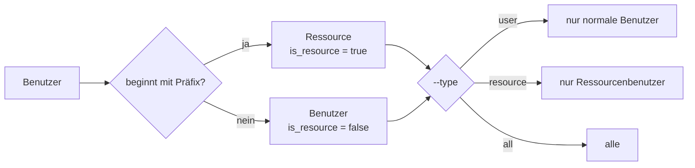

## OCS-Client

Der Client kapselt Basis-URL, Authentifizierung, Header, Timeout, TLS,
OCS-Prüfung, Paging und Rate-Limit-Verhalten.

### Request-Vertrag

Jeder Request enthält:

- HTTP Basic Auth mit Admin-Benutzer und App-Passwort,
- `OCS-APIRequest: true`,
- `Accept: application/json`,
- `format=json` als Query-Parameter,
- TLS-Prüfung, sofern `verify_tls` nicht bewusst deaktiviert wurde,
- Timeout aus `timeout_seconds`.

Der Client folgt Redirects. Schreibende Requests gibt es derzeit nicht.

### Paging

Beide Listen-Endpunkte werden mit `limit=500` und `offset` abgefragt. Das Paging
endet bei:

- einer leeren Seite,
- einer Seite mit weniger Einträgen als `limit`,
- einer wiederholten Seite ohne neue Kennungen,
- dem Sicherheitslimit von 10.000 Seiten.

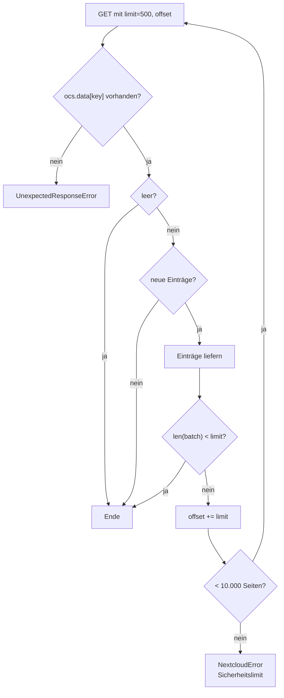

Die Mapping-Variante (`iter_paged_mapping`) erwartet `ocs.data[key]` als Objekt
mit Kennung als Schlüssel; die Listen-Variante (`iter_paged_list`) erwartet
eine Liste. Beide Varianten schützen vor Duplikaten.

### OCS-Antwortprüfung

Der Client erwartet:

```text
{
  "ocs": {
    "meta": {"status": "ok", "statuscode": 200, ...},
    "data": ...
  }
}
```

`ocs.meta.status` muss `ok` sein. Fehlt `status`, werden `statuscode` 100 und
200 sowie ein ganz fehlender Statuscode akzeptiert. Alles andere führt zu
`OCSResponseError`. `ocs.data` ist die Nutzlast; fehlt sie, wird ein leeres
Objekt verwendet.

## Fehlerabbildung

| Situation | Ausnahme | Exit-Code |
| --- | --- | --- |
| HTTP 401/403 | `AuthenticationError` | 3 |
| HTTP 429 nach drei Versuchen | `RateLimitError` | 4 |
| Anderer HTTP-Fehler | `NextcloudError` | 1 |
| Ungültiges JSON oder OCS-Struktur | `UnexpectedResponseError` | 1 |
| OCS `meta.status != ok` | `OCSResponseError` | 1 |
| Netzwerkfehler | `NextcloudError` | 1 |
| Inventarfehler | `InventoryError` | 1 |
| Ungültige Konfiguration | Pydantic `ValidationError` | 2 |

`AuthenticationError`, `OCSResponseError`, `RateLimitError` und
`UnexpectedResponseError` erben von `NextcloudError`. `InventoryError` ist eine
eigene Ausnahme, wird aber in der CLI ebenfalls auf Exit-Code 1 abgebildet.

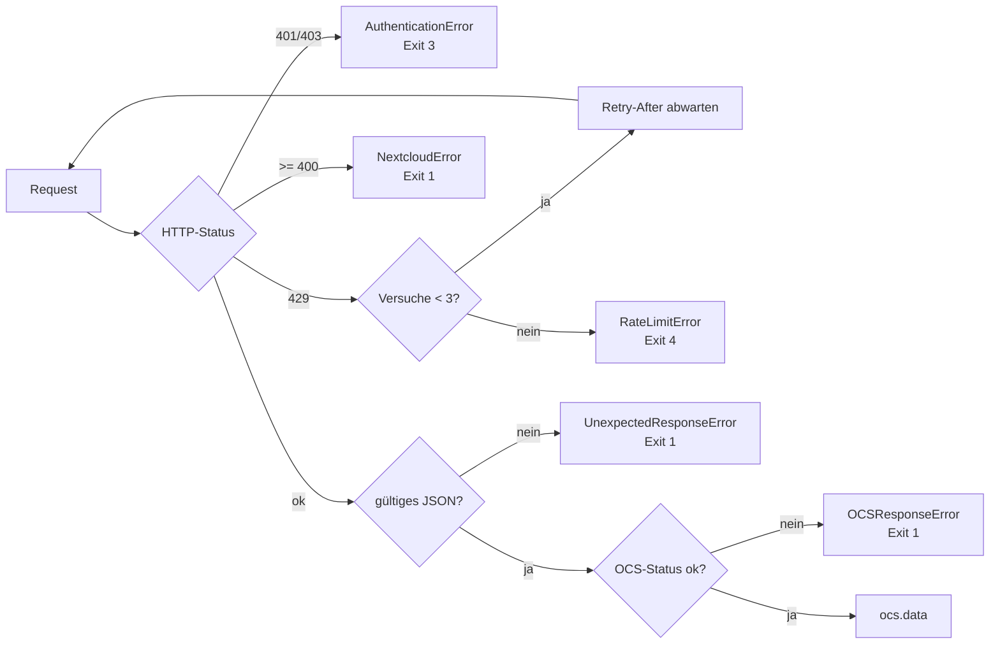

Bei HTTP 429 wird `Retry-After` respektiert. Das kann ein Sekundenwert oder ein
HTTP-Datum sein. Es wird höchstens dreimal versucht. Fehlt der Header, wartet
der Client 60 Sekunden. Negative oder ungültige Werte werden auf 0 beziehungsweise
den Standardwert normalisiert.

## Ausgabevertrag

### Tabelle

`users list` zeigt:

- Kennung
- Typ (`Benutzer`/`Ressource`)
- Name
- E-Mail
- letzte Anmeldung
- Gruppen
- Status (`aktiv`/`deaktiviert`)

`users stale` ergänzt:

- Angelegt
- Alter
- Inaktiv
- Altersherkunft indirekt über `Angelegt`/`Alter`

Die Tabelle wird mit Rich und einer festen Breite von 200 Zeichen ausgegeben.
Das verhindert abgeschnittene Spalten in typischen Terminals.

### JSON

`users list --json` liefert ein Array mit:

| Feld | Typ | Bedeutung |
| --- | --- | --- |
| `id` | String | Benutzerkennung |
| `display_name` | String | Anzeigename |
| `email` | String/`null` | E-Mail-Adresse |
| `enabled` | Boolean | Aktivierungsstatus |
| `is_resource` | Boolean | Kennung beginnt mit dem Ressourcenpräfix |
| `type` | String | `user` oder `resource` |
| `last_login` | ISO-8601/`null` | Letzte Anmeldung in `Europe/Berlin` |
| `groups` | Array | Objekte mit `id` und `display_name` |

`users stale --json` ergänzt unter anderem:

| Feld | Typ | Bedeutung |
| --- | --- | --- |
| `created_at` | ISO-8601/`null` | Exaktes Anlagedatum aus Import |
| `first_seen_at` | ISO-8601/`null` | Erste Sichtung im Inventar |
| `first_seen_source` | String/`null` | `baseline` oder `first_seen` |
| `age_days` | Integer/`null` | Alter in Tagen |
| `age_basis` | String | `exact`, `first_seen`, `first_login`, `last_login`, `pre_nc31`, `unknown` |
| `age_is_lower_bound` | Boolean | Alter ist nur Untergrenze |
| `age_bound_at` | ISO-8601/`null` | Zeitpunkt der Untergrenze |
| `first_login` | ISO-8601/`null` | Erstlogin |
| `last_login` | ISO-8601/`null` | Letztlogin |
| `inactive_days` | Integer/`null` | Tage seit letzter Anmeldung |
| `never_logged_in` | Boolean | Kein Erst- oder Letztlogin bekannt |

## Sicherheit und Datenschutz

- Basic Auth mit Admin-App-Passwort; die Share-Zugangsdaten sind derzeit
  ungenutzt.
- TLS-Prüfung ist standardmäßig aktiv und wird nicht pauschal deaktiviert.
- Secrets kommen ausschließlich aus Umgebung oder `.env`.
- `.env` ist ignoriert und nicht versioniert.
- `.adfc-nc/` mit dem Inventar ist ignoriert und enthält personenbezogene Daten
  wie Kennungen, Namen und E-Mail-Adressen. Es sollte geschützt und gesichert
  werden.
- Fehler enthalten keine Passwörter, Tokens oder vollständigen Antwortkörper.
- Die CLI führt derzeit nur GET-Requests aus.
- Das Inventar ist ein lokaler Zustand, kein Backup der Nextcloud-Datenbank.

## Teststrategie

- Unit-Tests mocken HTTP mit `respx`; es gibt keine echten
  Nextcloud-Aufrufe in der Standard-Testausführung.
- Inventar-Tests verwenden ein temporäres Verzeichnis, nie das echte
  `.adfc-nc/`.
- Künftige Integrationstests laufen nur mit gesetzten `ADFC_NC_TEST_*`-Variablen
  und werden sonst übersprungen; derzeit existieren keine Integrationstests.
- Jeder neue Befehl benötigt mindestens einen Erfolgs- und einen Fehlerfall.
- Die Tests decken Client, Normalisierung, Inventar und CLI-Filter ab.

## Bewusste Grenzen

- Die OCS-API liefert kein Anlagedatum. `EXACT` ist nur über einen späteren
  Import möglich.
- `firstLoginTimestamp == -1` bedeutet „vor Nextcloud 31“, nicht ein exaktes
  Datum.
- Der letzte Login ist ein kombinierter Wert für Web und Client.
- Es gibt keine Gerätezuordnung und keine verlässliche Aussage über jeden
  einzelnen Sync.
- Ressourcenbenutzer werden über ein Präfix erkannt; das ist eine Konvention,
  keine Metainformation der API.
- `cache_ttl_seconds` ist noch nicht implementiert.
- Schreibende Befehle (`create`, `disable`, `quota set`, Shares) fehlen noch.
- Es wird genau eine Instanz pro Konfiguration unterstützt.

## Erweiterungspunkte

Neue Ressourcen folgen dem bestehenden Muster:

1. Fachmodul unter `src/adfc_nc/nextcloud/` ergänzen.
2. Dataclasses und Normalisierung dort kapseln.
3. Dünnes Typer-Kommando unter `src/adfc_nc/commands/` anlegen.
4. Befehlsgruppe in `src/adfc_nc/cli.py` registrieren.
5. Ausgabe in `src/adfc_nc/output.py` ergänzen.
6. Erfolgs- und Fehlerfälle mit `respx` testen.
7. README, `docs/` und `AGENTS.md` aktualisieren.

Für schreibende Befehle kommen zusätzlich hinzu:

- `--dry-run` und Bestätigung ohne `--yes`,
- idempotentes Verhalten, wo fachlich möglich,
- keine Secrets in Logs oder Fehlermeldungen,
- Tests für Teilfehler und Wiederholungen.
